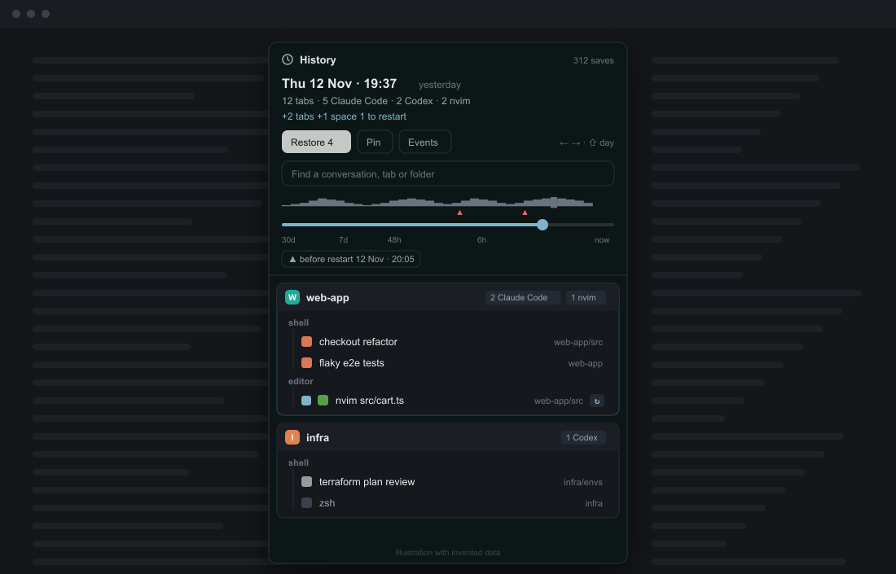

# session-restore

A History for Herdr. It saves what every pane runs, brings it back after a reboot or a crash, and
lets you go back to an earlier save. Like tmux-resurrect and tmux-continuum, with a timeline.

[](https://miguelalexanderdiaz.github.io/herdr-session-restore/)



- **Saves** your spaces, tabs and panes, with each pane's folder and what it runs, once every 60
  seconds. A save is only kept when something changed.
- **After a reboot or crash** Herdr gives every tab a fresh shell. session-restore restarts what ran
  there:
  - agent conversations, resumed by their id;
  - programs on a short allowlist (`nvim vim vi lazygit less htop btop yazi`).

  Anything else is left alone and listed in a notification, because blindly rerunning commands
  (`rm`, `git push`, a dev server) is dangerous.
- **History** (`ctrl-shift-o`): a slider over the saves, an activity strip, "before restart" jumps, a
  search box, and every space, tab and pane compared with now. Restore adds back what is missing and
  never closes anything.



[Usage](https://miguelalexanderdiaz.github.io/herdr-session-restore/usage.html) walks through the
window, the timeline and Restore, with an animation for each.

## Install

1. Run the installer. It says what the mod reaches and asks before writing anything.
   ```sh
   curl -fsSL https://raw.githubusercontent.com/miguelalexanderdiaz/herdr-session-restore/main/install/install.sh | sh
   ```
   On Windows (PowerShell):
   ```powershell
   irm https://raw.githubusercontent.com/miguelalexanderdiaz/herdr-session-restore/main/install/install.ps1 | iex
   ```
   It copies `mods/session-restore/`, merges `keys.json` and runs `herdr-app check`. By hand: copy
   `mods/session-restore/` into `<Herdr home>/mods/` and merge `keys.json` into yours.
2. **Add the background saver to every layout you use.** Herdr only runs a mod where a layout places
   it, so without this step nothing is saved. Add the entry in `snippets/layout-floating.json` to the
   root node's `"floating"` list in `<Herdr home>/layouts/<layout>.json`. It draws nothing. Herdr's
   own layouts (`main`, `terminals`, ...) are read-only, so clone one first:
   ```sh
   herdr-app do layout.clone '{"name":"main","as":"my-main"}'
   ```
   Saves appear in `<Herdr home>/session-restore/` within a minute.

Optional:
- **History as a side panel:** if your layout has a panel stack, add `snippets/panel-block.json` as one
  of its children.
- **Old screen text after a reboot:** add `restore_screen = true` to `~/.config/herdr-core/config.toml`.

To remove it, run the same command with `sh -s -- --uninstall`. Then delete the floating entry from
your layouts.

## Agents

An agent is resumed when two things are known: its resume command and its conversation id. The commands
come from Herdr's own integrations:

| Agent | Resume command |
|---|---|
| Claude Code | `claude --resume <id>` |
| Codex | `codex resume <id>` |
| Copilot CLI | `copilot --resume=<id>` |
| OpenCode, Kimi, Kilo | `<agent> --session <id>` |
| Cursor Agent | `cursor-agent --resume <id>` |
| Grok, Hermes, Qoder, Droid, Devin, Qwen | `<agent> --resume <id>` |
| Antigravity, Letta | `<agent> --conversation <id>` |
| OMP | `omp --resume=<id>` |
| MastraCode | `mastracode --thread <id>` |

Others (Pi, Gemini, Amp, ...) are listed in the notification and come back as a shell.

The id:
- **Claude Code:** no setup needed. It keeps a record per running process (`~/.claude/sessions/`).
- **Any other agent:** wire `hooks/session-restore-hook.sh` to its session-start hook. It reads the
  hook's JSON on stdin and labels the Herdr terminal with its `session_id`.
  `snippets/claude-hooks.json` shows the shape, using Claude Code's `settings.json` as the example.

## Privacy and permissions

- **Network:** none.
- **Runs:** Herdr's `hc`:
  - `hc get`, to see what each pane runs;
  - `hc server status`, to tell a restart;
  - `hc send`, to type a restart line into a pane that is a bare shell.

  And `herdr-app do`, only to recreate the tabs and spaces you choose to restore.
- **Reads:** `~/.claude/sessions/<pid>.json` for Claude Code conversation ids and names. Only when you
  open a Claude pane's details, also `~/.claude/history.jsonl`, to show your last prompt.
- **Writes:** only `<Herdr home>/session-restore/` (saves, `index.json`, `pins.json`, `state.json`).

Herdr does not sandbox mods. This is a promise of this code, and `scripts/validate.mjs` checks it on
every change.

## Keeping saves

Every distinct save from the last 48 hours, then the newest of each day for 30 days. The 10 newest
saves and the ones you pin are always kept. Saves are a few KB each.

## Limits

- **Saving:** only happens while Herdr is open, and only in layouts with the saver from step 2.
- **Split shapes:** a closed tab comes back with its panes stacked, because Herdr doesn't give mods
  the split shape. Tabs that are still open keep their exact layout.
- **Scope:**
  - Terminals on other machines aren't covered.
  - Unsaved editor changes aren't recovered.
  - The mod has only run on macOS.

## Develop

```sh
node --test
node scripts/check-local.mjs
```

[CONTRIBUTING.md](CONTRIBUTING.md) has the rest, and [AGENTS.md](AGENTS.md) has notes for AI agents.
