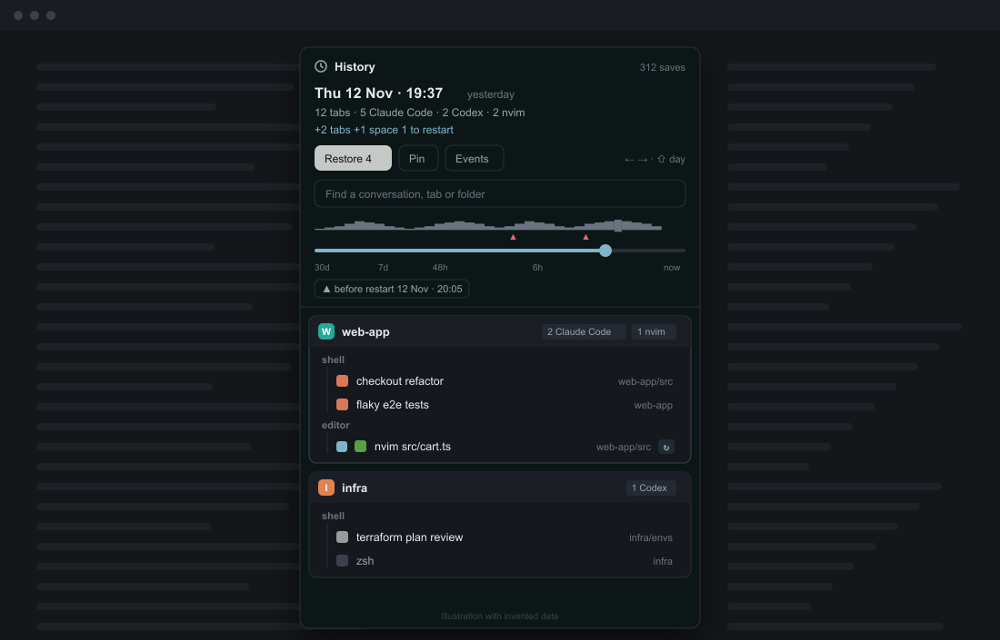

# session-restore

A History for Herdr. In the background it saves what every pane runs, once every 60 seconds. After a
reboot or crash it restarts what ran in each pane: agent conversations by their id, and a short list of
safe programs. A History window lets you move along a timeline of saves and restore what is missing.

## What you see

- **Nothing at first.** A hidden copy of the mod runs in a floating block that draws nothing.
- **After a reboot:** one notification, "Restored 3 claude, 1 nvim", that also lists any command it left
  alone.
- **The History**, a popup 640px tall and 440px wide at the top of the window (`ctrl-shift-o`), or the
  same view in a layout's side panel:
  - **Header:** a clock icon and "History" on the left, "N saves" on the right. Below them:
    - the chosen save's date, "Fri 13 Nov · 08:40", in 15px semibold, with "12h ago" or "latest save"
      dimmed;
    - its counts: "16 tabs · 14 Claude Code · 2 nvim";
    - how it differs from now, "+2 tabs  +1 space  3 to restart", or "same as now".
  - **Buttons:** Restore N, a solid button, or a dimmed "Nothing to restore". Then Pin (Unpin) and
    Events (Hide events), with "← → · ⇧ day" on the right.
  - **Events:** a list of what changed since the save before, in a surface box, when Events is open.
  - **Search:** a box with the placeholder "Find a conversation, tab or folder".
  - **Timeline:**
    - an activity strip of `▁..█` cells, whose height is the busiest save in each cell;
    - a red `▲` under each cell where the terminal service restarted;
    - a slider with a 14px thumb;
    - tick labels 30d, 7d, 48h, 6h and now;
    - up to three "▲ before restart <date>" chips.
  - **Tree:** a card per space, 8px corners, on the surface color. Its 34px header is on the raised
    color and has:
    - an 18px letter badge in the space's color: the layout's shared `space.colors` when it has one,
      otherwise one of six theme colors picked by the space id;
    - the name in 13px semibold;
    - chips such as "3 Claude Code" and "1 app".

    Each tab is its name in 11px with its panes hanging off a guide line. Each pane row is 26px: an
    optional tick box, the program icon from Herdr's program table, the agent's conversation name or the
    program, the last two folders, and a mark only when it differs from now: `↻` can restart, `~` runs
    something else now, `+` closed since. A card with changes has a stronger border, and a closed space
    shows "closed since".
  - **Legend:** a line at the end of the tree explaining the marks.

## How it behaves

- **Saving:**
  - every 60 seconds the hidden copy reads what each pane runs (`hc get` for panes that are not a bare
    shell);
  - it compares that with the last save and writes a new `snap-<time>.json` only when something
    differs (times are ignored);
  - it then bumps the shared `session-restore.rev` so an open History reloads.
- **Agents:** a pane is an agent when Herdr's program table says so (`program.agent`) or the agent
  reports an app.
  - Its conversation id comes from Claude Code's `~/.claude/sessions/<pid>.json` (id and name). Any
    agent can also have it from the terminal label `session-restore.session`, set by
    `hooks/session-restore-hook.sh`.
  - It resumes with the agent's command from Herdr's integrations (`claude --resume <id>`,
    `codex resume <id>`, ...). With no id or no known command, it comes back as a shell and is listed.
- **After a restart:** the terminal service's start time is `now - uptime` from `hc server status`. When
  it differs by more than a minute from the restart last handled (`state.json`):
  - the mod takes the last save from before that start;
  - for each pane that is now a bare shell and ran an agent with an id, or a program on the allowlist
    `nvim vim vi lazygit less htop btop yazi`, it types `cd <folder> && <command>` with `hc send`;
  - it makes two passes, 3 and then 10 seconds after the start, and types into each pane once at most.

  Closed tabs are not rebuilt on their own.
- **History:**
  - **Moving:** the slider is log-compressed, so the last hours get most of the width, and snaps to the
    nearest save. `←` `→` step one save, and `shift` with them jumps a day. Clicking a strip cell or a
    "before restart" chip picks that save.
  - **Search:** jumps to the newest save whose spaces, tabs, folders or conversation names contain the
    text.
  - **Following:** while on the newest save, the History follows new saves.
- **Compare:** each save is compared with the live state, not with the newest save. A pane whose
  terminal still exists is the same, can restart (now a bare shell), or is different. A tab whose panes
  are all gone is closed since.
- **Restore:**
  - restartable panes get their line typed in;
  - closed tabs are rebuilt with `herdr-app do tab.new` (and `space.new` for a closed space), with
    `terminal.open` for further panes, each started with its program;
  - unticked rows are skipped;
  - nothing open is closed or replaced;
  - a notification says what came back.
- **Pane details:** clicking a pane shows its folder and branch. For an agent it also shows the
  conversation name and id, and for Claude Code the last prompt from `~/.claude/history.jsonl`.
- **Keeping saves:**
  - every distinct save from the last 48 hours;
  - then the newest save of each day for 30 days;
  - always the 10 newest saves, and pinned ones (`pins.json`).

## Built from

- **Files:**
  - `mods/session-restore/main.js`: the View, in two roles. `props.role === "background"` is the saver,
    which renders an empty `div()`; any other copy is the History.
  - `logic.mjs`: pure functions such as `program`, `buildSnapshot`, `compare`, `plan`, `autoActions`,
    `prune`, `position`, `strip`, `events` and `RESUME`.
  - `mod.json`: `place: "none"`, `overlay: popup, at top, offset 40, 440 x 640`.
  - `clock.svg`.
- **Herdr functions:** `spaces`, `panes`, `terminals`, `machines`, `hc`, `exec`, `home`, `appHome`,
  `props`, `shared`, `setShared`, `notify`, `theme`. Also `fs/promises` (`readFile`, `writeFile`,
  `mkdir`, `unlink`).
- **gpui-base:** `InputState`/`Input` for the search box, and `Slider`, `SliderState`, `SliderTrack`,
  `SliderIndicator` and `SliderThumb` for the timeline.
- **Programs:**
  - `hc get <t>`, `hc server status` and `hc send <t> <line>`;
  - `herdr-app do space.new | tab.new | terminal.open` with one JSON object.
- **Layout:** a root `floating` entry
  `{ "id": "session-restore-bg", "content": { "mod": "session-restore", "props": { "role": "background" } } }`.
  Optionally a `history` block in a panel stack.
- **Storage:** `<Herdr home>/session-restore/`. It holds `snap-<ISO time>.json` files, each a
  `{ v, at, coreStart, spaces: [{ id, name, folder, tabs: [{ id, name, panes: [{ pane, terminal, cwd, branch, icon, tint, label, prog }] }] }] }`.
  It also holds `index.json` (`{ file, at, coreStart, counts, text }` per save), `pins.json` and
  `state.json` (`restoredFor`).

## Watch out

- **A layout entry is needed.** Herdr runs a mod only where a layout places it, so the saver needs the
  floating entry in every layout. Without it nothing is saved.
- **Popup height.** As a popup the window sizes to its content. The root gets its own height (640),
  otherwise the tree collapses to nothing.
- **Dates.** The app ignores `toLocaleString` options, so dates are formatted by hand (`when()`).
- **The slider.** `SliderState` belongs in `init`, and it needs a `SliderIndicator` or it cannot move.
- **Matching after a reboot.** After a reboot Herdr keeps terminal addresses, so a save's panes match
  the recovered terminals by address. A restore can only type into a pane that is a bare shell now.
- **Undocumented Claude files.** Claude Code's per-process record is not a documented interface, which is
  why the hook is a backup. Reading `~/.claude/history.jsonl` is limited to when you open a Claude
  pane's details.
- **Split shapes.** Mods don't get a tab's split shape, so a rebuilt tab stacks its panes downwards.
- **Coverage.** Only this computer's spaces are saved, and nothing is saved while Herdr is closed.

## Done when

- `herdr-app check <home>/mods/session-restore` passes, and `node --test` passes.
- **Saving:** with the floating entry in a layout, a `snap-*.json` appears in
  `<Herdr home>/session-restore/` within a minute, and no new one appears while nothing changes.
- **Restore in place:** start `less` in a tab, wait for a save, then quit it. Pick that save in the
  History and press Restore, and `less` runs again in that tab.
- **Rebuild:** close that tab, wait for a save, then pick the earlier save and Restore. The tab comes
  back with `less` running.
- **History:** `ctrl-shift-o` opens it in a layout that has no panel, the slider and `←` `→` move
  between saves, and the header shows how each one differs from now.
